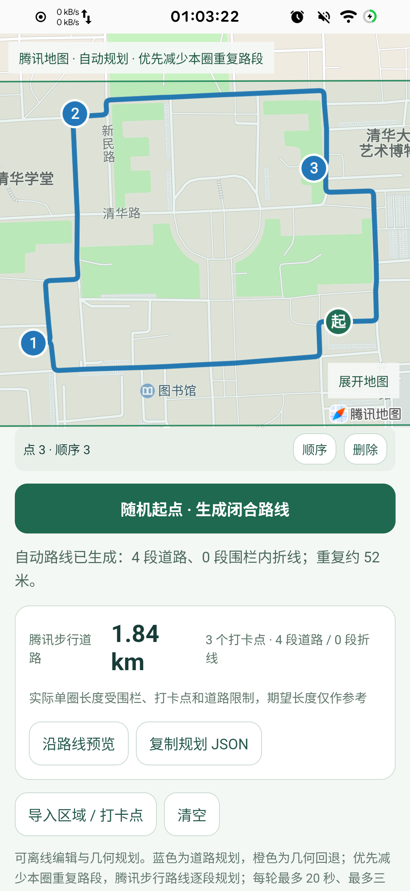
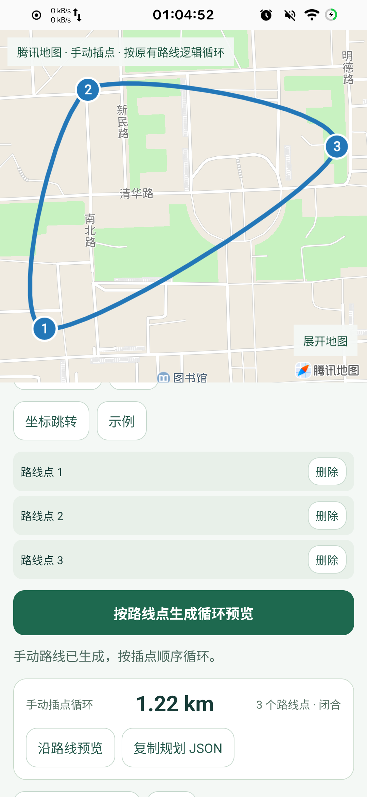
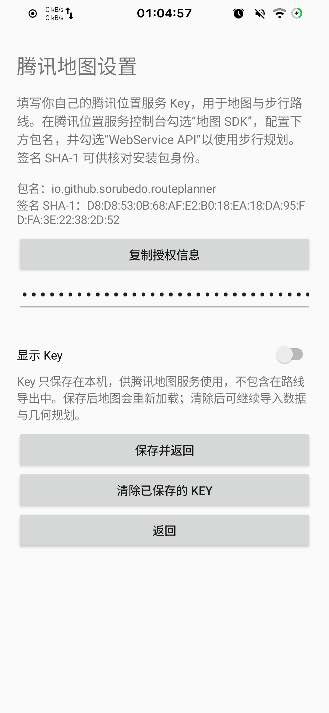

# 路线规划

一款 Android 路线规划工具，可在地图上划定范围、添加途经点，生成闭合步行路线，也可以手动插点绘制路线。

[下载最新版 APK](https://github.com/sorubedo/route-planner/releases/latest)

- 自动规划：设置期望单圈长度，按需选择顺序打卡，生成经过全部点位的闭环。
- 手动插点：按地图上的插点顺序生成路线。
- 地图预览：支持普通地图、卫星图、坐标跳转和沿路线播放。
- 数据管理：保存编辑内容，支持导入、导出路线 JSON。
- 自定义腾讯地图 Key：在应用内填写、修改或清除自己的 Key。

## 软件截图

| 自动规划 | 手动路线 | 地图设置 |
| :---: | :---: | :---: |
|  |  |  |

## 开始使用

需要 Android 8.0 或更高版本。

1. 从 Releases 下载并安装 APK。
2. 打开「地图设置」，复制包名与签名信息。
3. 在[腾讯位置服务控制台](https://lbs.qq.com/dev/console/application/mine)创建自己的 Key，勾选「地图 SDK」并填写应用包名，同时勾选「WebService API」以使用步行路线服务。可参考[官方申请说明](https://lbs.qq.com/mobile/androidMapSDK/developerGuide/getKey)。
4. 将 Key 填入应用并保存，同意地图服务说明后即可使用。
5. 划分区域、插入打卡点，设置长度后点击「生成闭合路线」；也可切换为手动插点。

正式发布包的授权信息：

```text
包名：io.github.sorubedo.routeplanner
SHA-1：D8:D8:53:0B:68:AF:E2:B0:18:EA:18:DA:95:FD:FA:3E:22:38:2D:52
```

应用不内置地图 Key。自行构建的安装包请以「地图设置」中显示的签名为准。

## 路线与数据

蓝色表示腾讯步行道路，橙色表示道路规划失败后的几何连线。橙色路段可能经过建筑、水域或封闭区域，出行前请核对实际通行条件。期望长度仅供参考，实际长度受区域、点位和道路限制。

支持最多 8 个区域、每区 80 个顶点、24 个打卡点，或 200 个手动路线点。导入 JSON 时须明确标注 `WGS84` 或 `GCJ-02` 坐标系。

地图 Key 保存在本机，路线导出不含 Key。地图和步行规划需要联网，相关地图范围、路线端点会发送给腾讯地图服务；应用不申请定位权限。未配置 Key 时，可以导入数据，并关闭「优先步行道路」进行几何规划。

开发与构建说明见 [docs/build.md](docs/build.md)。
